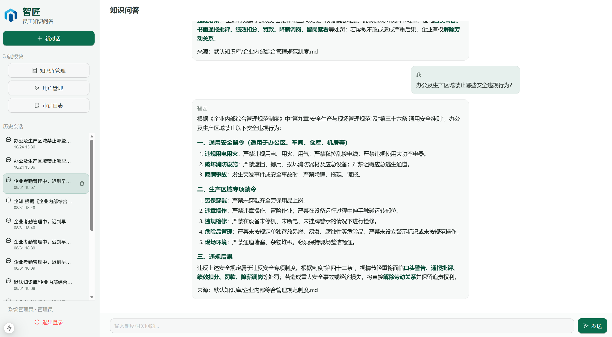

# 智匠 · 企业内部知识问答智能体

基于 **智匠・工业大模型** 与 **RAG**，面向企业内部制度问答：员工用自然语言提问，系统从已入库文档检索片段，由 Agent 生成带出处的回答。

仓库：[https://github.com/MINGC0816/QIZHI](https://github.com/MINGC0816/QIZHI)

当前为 **V2**：JWT 登录、会话按用户隔离、多知识库分集合索引。知识库管理与系统管理需要管理员权限。



---

## 功能概览

| 模块 | 路径 | 说明 |
| --- | --- | --- |
| 登录 / 注册 | `/auth/login` `/auth/register` | 注册只能创建普通用户；管理员由 `.env` 初始化 |
| 员工问答 | `/` | 多轮对话、NDJSON 流式输出、工具调用时间线；会话按 `user_id` 隔离 |
| 知识库管理 | `/admin` | 多知识库 CRUD、上传、重建索引、召回对比、原文/切片预览 |
| 系统管理 | `/manage` | 用户管理、审计日志（仅 admin） |
| 检索 | — | BM25 + 向量 RRF；本地有 `bge-reranker-base` 时再交叉编码重排，没有则自动降级 |
| Agent 工具 | — | `rewrite_query` / `search_knowledge` / `list_documents` |

普通用户不能改索引。进入知识库管理前，可用管理员账号做一次 `kb-admin-login` 二次验证。

---

## 技术栈

| 层级 | 技术 |
| --- | --- |
| 大模型 | 内网 vLLM（OpenAI 兼容），默认 `Qwen3.5-VL-122B` |
| Agent | LangChain `create_agent` + LangGraph `SqliteSaver` |
| RAG | jieba + rank-BM25 + Chroma 向量 + RRF；可选 `bge-reranker-base` |
| Embedding | `BAAI/bge-small-zh-v1.5`（本地目录，不进 Git） |
| 后端 | Python 3.11+、FastAPI、Uvicorn |
| 前端 | Next.js 15、TypeScript、Ant Design 6 |
| 鉴权 | JWT + bcrypt；问答接口除健康检查外需 Bearer Token |
| 可观测 | 本地 `data/traces/`；配置 Langfuse 后同步线上 |

---

## 系统架构

```
登录(JWT) → 选择绑定知识库的会话
    ↓
员工提问 → Agent：必要时 rewrite_query
    ↓
search_knowledge：BM25 + 向量（RRF，可选 Rerank）
    ↓
内网 LLM 生成 → 系统拼接「来源：知识库/文件」（去掉模型自编来源）
    ↓
LangGraph Checkpoint + chat_threads（按 user_id 隔离）
```

管理员在 `/admin` 维护各库文档与召回对比，在 `/manage` 管用户和审计。

| 路径 | 内容 |
| --- | --- |
| `data/kbs/<kb_id>/raw/` | 各知识库原始文档（启动时会把旧的 `data/raw/` 迁到默认库） |
| `data/chroma/` | 按知识库分集合的向量索引 |
| `data/db/kb_agent.db` | 用户、审计、知识库元数据、会话、LangGraph Checkpoint |
| `data/traces/` | 本地 Agent 轨迹（可选同步 Langfuse） |
| `data/eval/` | 黄金集评测报告（运行时生成，不入库） |

---

## 环境要求

- Python ≥ 3.11
- Node.js ≥ 18（推荐 20+）
- 可访问的内网 vLLM（需 VPN 时先连 VPN）
- Embedding 权重约 90MB，放到 `models/bge-small-zh-v1.5/`（默认不随 Git 提交）

---

## 配置与安装

### 1. 克隆仓库

```bash
git clone https://github.com/MINGC0816/QIZHI.git
cd QIZHI
```

### 2. 安装后端依赖

启动脚本会依次查找 `../.venv` 与 `.venv`。

```bash
# Windows
python -m venv .venv
.\.venv\Scripts\pip install -e ".[dev]"

# Linux / macOS
python3 -m venv .venv
.venv/bin/pip install -e ".[dev]"
```

`[dev]` 含 pytest 与可选的 langfuse。只要跑服务可以只 `pip install -e .`。

### 3. 配置环境变量

```bash
cp .env.example .env
```

至少确认这些项：

```ini
VLLM_BASE_URL=http://10.60.40.130:12333/v1
VLLM_API_KEY=EMPTY
VLLM_MODEL=Qwen3.5-VL-122B
VLLM_ENABLE_THINKING=false

EMBEDDING_MODEL_PATH=models/bge-small-zh-v1.5
RERANKER_MODEL_PATH=models/bge-reranker-base
RETRIEVE_MODE=hybrid_rerank
RETRIEVE_TOP_K=4
RETRIEVE_CANDIDATE_K=20

JWT_SECRET=change-me-in-production
DEFAULT_ADMIN_USERNAME=admin
DEFAULT_ADMIN_PASSWORD=admin123
```

`RERANKER_MODEL_PATH` 指向的目录不存在时，检索自动降为 BM25 + 向量，**不阻断启动**。生产环境务必改 `JWT_SECRET` 和默认管理员密码。

验证模型服务：

```bash
curl http://10.60.40.130:12333/v1/models
```

### 4. 准备 Embedding 模型

将 `bge-small-zh-v1.5` 放到 `models/bge-small-zh-v1.5/`，目录中应有 `config.json`、`model.safetensors`、`tokenizer.json` 等。详见 [models/README.md](./models/README.md)。

可选重排模型（约 1GB）：

```bash
python scripts/download_reranker.py
```

### 5. 安装前端依赖

```bash
cd web
npm install
cd ..
```

使用一键启动时：若还没有 `web/node_modules` 会自动 `npm install`；`web/.env.local` 也会自动生成，默认代理到 `http://127.0.0.1:8002`。

---

## 启动

### 一键启动（推荐）

前后端同一终端，`Ctrl+C` 同时停止并释放端口。

```bash
# Windows
.\start.bat
# 或
.\start.ps1

# Linux / macOS
chmod +x start.sh
./start.sh
```

自定义端口：

```bash
# Linux / macOS
API_PORT=8002 WEB_PORT=3000 ./start.sh

# Windows PowerShell
.\start.ps1 -ApiPort 8002 -WebPort 3000
```

| 入口 | 地址 |
| --- | --- |
| 登录 | http://127.0.0.1:3000/auth/login |
| 员工问答 | http://127.0.0.1:3000 |
| 知识库管理 | http://127.0.0.1:3000/admin |
| 系统管理 | http://127.0.0.1:3000/manage |
| API 文档 | http://127.0.0.1:8002/docs |
| 健康检查 | http://127.0.0.1:8002/health |

默认账号：`admin` / `admin123`（仅开发环境）。

### 手动分别启动

```bash
# 终端 1 — 后端
.\.venv\Scripts\python -m uvicorn src.api.main:app --host 127.0.0.1 --port 8002 --reload --reload-dir src

# 终端 2 — 前端
cd web
echo API_ORIGIN=http://127.0.0.1:8002 > .env.local
npm run dev -- --port 3000 --hostname 127.0.0.1
```

Linux / macOS 把 `.\.venv\Scripts\python` 换成 `.venv/bin/python`。

---

## 使用说明

### 知识库入库（推荐走管理页）

1. 用管理员登录，打开 `/admin`，可新建多个知识库
2. **上传文档** → 保存到 `data/kbs/<kb_id>/raw/`（此时尚未向量化）
3. **重建索引** → 解析、分块、Embedding，写入该库的 Chroma 集合
4. 员工在问答页选择绑定该库的会话后提问

简略问法会先走 `rewrite_query` 再检索。回答末尾由系统拼接真实来源，例如 `来源：默认知识库/企业内部综合管理规范制度.md`。

### 命令行批量入库

写入**默认知识库**集合，适合快速灌 `samples/` 或旧的 `data/raw/`：

```bash
python scripts/ingest_folder.py --samples
python scripts/ingest_folder.py
python scripts/ingest_folder.py --dir D:\docs
```

多知识库场景请用 `/admin` 上传并重建索引。

### 支持的文档格式

- PDF（优先抽文本层；乱码或扫描件回退 OCR）
- Word（`.docx`）
- Markdown（`.md`）/ 纯文本（`.txt`）

---

## 主要 API

除 `/health`、`/api/v1/auth/register`、`/api/v1/auth/login` 外，均需 `Authorization: Bearer <token>`。管理类接口还要求 admin。

| 方法 | 路径 | 说明 |
| --- | --- | --- |
| GET | `/health` | 健康检查 |
| POST | `/api/v1/auth/register` `/login` `/logout` | 注册、登录、登出 |
| GET | `/api/v1/auth/me` | 当前用户 |
| POST | `/api/v1/auth/kb-admin-login` | 进入知识库管理的二次验证 |
| GET / POST / DELETE | `/api/v1/threads` | 会话（按登录用户隔离） |
| POST | `/api/v1/chat` | 同步问答 |
| POST | `/api/v1/chat/stream` | 流式问答（工具时间线 + token） |
| GET | `/api/v1/kbs` | 问答页可选知识库列表 |
| GET / POST / PATCH / DELETE | `/api/v1/admin/kbs` | 知识库 CRUD |
| GET | `/api/v1/admin/kbs/{id}/recall` | 召回对比：仅向量 / BM25+向量 / 混合+Rerank |
| POST | `/api/v1/admin/kbs/{id}/upload` `/ingest` | 上传原文、重建该库索引 |
| GET | `/api/v1/admin/users` `/audit-logs` | 用户与审计 |

`/api/v1/upload`、`/api/v1/ingest`、`/api/v1/documents` 是旧路径兼容，同样需要管理员权限。

---

## 检索、评测与测试

默认链路：BM25（jieba）与向量各召回 `RETRIEVE_CANDIDATE_K` 条，RRF 融合；若本地存在 `models/bge-reranker-base`，再对融合结果做 CrossEncoder 重排并截到 `RETRIEVE_TOP_K`。Admin「召回测试」三列并排，缺 reranker 时第三列不会出现真实重排结果。

本机黄金集（32 题，独立集合 `eval_golden`，不污染业务库）实测，**当时未加载 reranker**：

| 模式 | Recall@1 | Recall@5 |
| --- | --- | --- |
| 仅向量 | 75.0%（24/32） | 96.9%（31/32） |
| BM25 + 向量 | 81.2%（26/32） | 100%（32/32） |
| 混合 + rerank | 未测 | 未测 |

语料是 `samples/` 示例制度 + `evals/distractors/` 干扰文档，细粒度分块。Recall@5 只多对 1 题，更有对比意义的是 Recall@1。不能写成「重排后提升」。

```bash
# 黄金集评测，报告写入 data/eval/last_report.json
python scripts/eval_retrieval.py

# 鉴权 / 来源拼接 / 查询改写（16 项）
python -m pytest tests -q

# 失败轨迹：rewrite → 空检索 → 拒答
python scripts/demo_fail_trace.py
```

配置 `LANGFUSE_PUBLIC_KEY` / `LANGFUSE_SECRET_KEY` 后，问答会打到 Langfuse；不填或未安装 langfuse 时只写 `data/traces/`。失败样例另存在 `evals/sample_fail_trace.json`。

---

## 项目结构

```
QIZHI/
├── start.bat / start.ps1 / start.sh
├── Dockerfile / docker-compose.yml / docker/
├── .env.example
├── pyproject.toml
├── 演示图片.png
├── samples/                           # 示例制度
├── evals/
│   ├── golden_set.json                # 32 题黄金集
│   ├── sample_fail_trace.json
│   └── distractors/                   # 评测干扰文档
├── scripts/
│   ├── ingest_folder.py
│   ├── eval_retrieval.py
│   ├── demo_fail_trace.py
│   ├── download_reranker.py
│   └── docker-export / docker-import
├── tests/                             # pytest
├── models/README.md
├── src/
│   ├── config.py / llm.py / tracing.py
│   ├── ingest/                        # 解析、分块、入库
│   ├── rag/                           # hybrid / rerank / Chroma
│   ├── agent/                         # 工具、改写、来源拼接
│   ├── auth/                          # JWT、用户、审计
│   ├── kb/                            # 多知识库注册表
│   ├── api/                           # FastAPI
│   └── sessions/
└── web/                               # Next.js
```

`.env`、`models/` 权重、`data/` 运行数据、`web/node_modules`、`web/.next` 不进 Git。

---

## 日志

| 位置 | 说明 |
| --- | --- |
| `data/logs/app.log` | 常规运行日志 |
| `data/logs/error.log` | ERROR |
| `data/api.out.log` / `data/api.err.log` | 启动脚本捕获的 API 输出（Windows） |
| `data/api.log` | Linux / macOS 下 API 日志 |

日志级别用 `.env` 的 `LOG_LEVEL`。

---

## 部署注意

1. **vLLM 工具调用**：服务端需 `--enable-auto-tool-choice --tool-call-parser qwen3_xml`（或对应 Qwen 解析器），否则 Agent 调不了检索工具。
2. **Embedding 离线**：保证 `models/bge-small-zh-v1.5` 完整，或把 `EMBEDDING_MODEL_PATH` 写成绝对路径。
3. **Reranker 可选**：缺权重就降级为混合检索，不要当成故障。
4. **勿提交**：`.env`、`data/`、`web/.env.local`、`web/node_modules`、模型权重。
5. **热重载**：改 `src/` 会重启 API；期间前端可能短暂 `ECONNRESET`，刷新即可。
6. **PDF**：文本层优先；Identity-H 乱码或扫描件走 OCR，尽量用可复制文本的版本。
7. **Langfuse**：不填 key 不影响启动。

---

## Docker 离线部署

单个镜像同时跑 FastAPI（`:8002`）和 Next.js（`:3000`）。vLLM 不打进镜像，Embedding 会打进镜像。步骤见 [docker/README.md](./docker/README.md)。

```bash
# 有网机构建并导出（需 models/bge-small-zh-v1.5 完整）
./scripts/docker-export.sh          # Windows: .\scripts\docker-export.ps1

# 无网机
cd dist
cp .env.example .env                # 填写 VLLM_BASE_URL、JWT_SECRET、管理员密码
./docker-import.sh
```

访问 `http://<服务器IP>:3000`。数据在 Docker volume，升级镜像不丢知识库。
